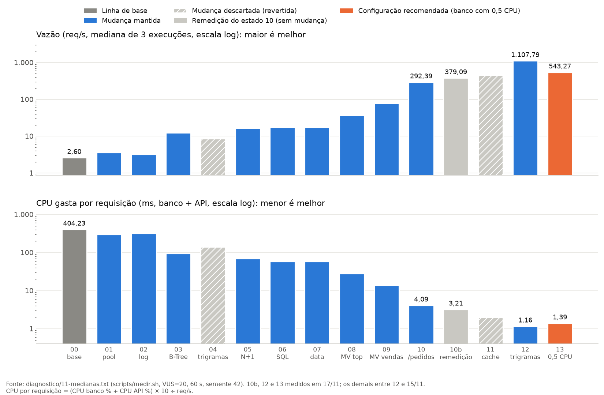

# Índices e consultas certas, não mais hardware: a API da loja passou de 2,60 para 543,27 req/s com um terço a menos de CPU

## 1. Resumo

Uma API de loja em Node.js e PostgreSQL atendia 2,60 req/s, com o banco no limite de CPU. Corrigi uma causa por vez: conexão por consulta, falta de índices, consultas em laço, relatórios recalculados e busca sem índice. Sem mudar respostas, a API chegou a 1.107,79 req/s com o hardware original e a 543,27 req/s com o banco em 0,5 vCPU, um terço a menos no total. Cada requisição gasta menos de 0,5% da CPU original.

## 2. Contexto e diagnóstico

Medi com o script do desafio: 20 usuários virtuais por 60 s em carga fechada (cada um só envia a próxima requisição depois de receber a anterior), três vezes por configuração, comparando a mediana. Na [linha de base](../resultados/20261112-095440-00-linha-de-base/resumo.txt), a API atendia 2,60 req/s com p95 de 25.286,5 ms; o banco usava 97,7% da sua CPU e a API, 6,7%. O gargalo era o banco. Para descobrir onde, listei os [índices](../diagnostico/01-indices-originais.txt), as [leituras por tabela](../diagnostico/02-estatisticas-tabelas-base.txt) e os [planos de execução](../diagnostico/03-explain-analyze-original.txt) de cada rota.

Hipóteses de causa, uma por problema:

- **H1, conexões:** abrir e fechar uma conexão por consulta (`api/src/db.js`) obriga o PostgreSQL a criar um processo a cada consulta.
- **H2, índices:** só havia chaves primárias; buscas por e-mail, cliente, pedido e status liam tabelas inteiras. Só `itens_pedido` teve 1.273.500.000 linhas lidas por varredura sequencial na linha de base.
- **H3, consultas em laço:** `/clientes/:id/pedidos` faz uma consulta por pedido e outra por item, cerca de 22 por chamada.
- **H4, relatórios:** `top-produtos` soma 1,5 milhão de itens a cada chamada (1.100,1 ms no plano); `vendas-por-dia` traz linhas brutas para somar no Node.js.
- **H5, paginação:** `/pedidos` conta o status inteiro e ordena em disco a cada página (`external merge` com 32.640 kB).
- **H6, log:** cada resposta é serializada de novo e escrita no stdout ([amostra](../diagnostico/04-amostra-logs-api.txt)).
- **H7, busca:** `ILIKE '%termo%'` lê a tabela de produtos inteira; só apareceu depois das outras correções ([pg_stat_statements](../diagnostico/06-pg-stat-statements-estado-10.txt) [19]).

## 3. Estado da arte

### Conexões

O PostgreSQL atende cada conexão com um processo próprio, e manter ou abrir muitas conexões custa memória e CPU [1]. A documentação do driver `node-postgres` recomenda um *pool*, que reaproveita conexões já abertas [2].

### Índices e busca textual

Desde Selinger et al. [3], otimizadores escolhem por estimativa de custo entre ler a tabela inteira e usar um índice. A documentação do PostgreSQL descreve índices compostos e cobridores, que respondem só com o índice (*Index-Only Scan*) [4, 5]; para comparar `lower(email)` é preciso indexar a própria expressão [6]. Índices B-Tree não atendem busca por um trecho no meio do texto. Para isso, o módulo `pg_trgm` indexa trigramas, sequências de três caracteres [7], abordagem que o GitLab usou na busca do seu produto [8].

### Fazer o trabalho no lugar certo

O banco tem algoritmos próprios de junção e agregação [9]; por isso, reescrever a consulta para que ele faça esse trabalho costuma render mais do que fazê-lo na aplicação. Quando o cálculo é caro e o dado muda pouco, dá para guardá-lo pronto: uma *materialized view* grava o resultado, que fica defasado até um `REFRESH` [10]; com `CONCURRENTLY`, o `REFRESH` não bloqueia leituras, mas exige um índice único [11]. Um cache na aplicação faz a mesma troca de atualidade por velocidade, fora do banco [12, 13]. No Node.js, `console.log` pode ser síncrono e `JSON.stringify` é caro em objetos grandes; os dois travam o *event loop* [13, 14].

### Como medir

A documentação do k6 descreve a carga com usuários fixos como modelo fechado, em que a vazão depende do tempo de resposta do sistema [15], e Schroeder et al. mostram que modelos fechados e abertos podem levar a conclusões diferentes [16]. Um limite de "1 CPU" no Docker é uma cota por período de 100 ms [17]; quem a esgota fica pausado até o período seguinte [18]. Na minha leitura, isso muda a interpretação: em carga fechada, a CPU do gargalo fica perto de 100% mesmo com a aplicação eficiente, então o custo precisa ser medido por requisição.

## 4. Alternativas consideradas

| Alternativa | Custo | Desempenho | Risco | Esforço |
| --- | --- | --- | --- | --- |
| A. Corrigir consultas e índices (pool, índices, `JOIN`, agregação no SQL) | Nenhum recurso extra | Alto onde há leitura de tabela inteira | Baixo; índices encarecem escritas | Médio |
| B. Pré-calcular relatórios e contagens (*materialized views*) | Pouco disco; `REFRESH` periódico | Alto nos relatórios | Dado defasado até o `REFRESH` | Baixo |
| C. Cache em memória na API | CPU e RAM da API | Alto em buscas repetidas | Estado por réplica; acerto depende dos termos | Baixo |
| D. PgBouncer ou Redis | Um container a mais cada | Útil com várias réplicas da API | Operação e invalidação | Médio-alto |
| E. Mais CPU e memória | Mais vCPU na fatura | No máximo proporcional ao recurso | Baixo | Mínimo |

A tabela registra o que eu esperava antes de medir. A e B atacam as causas H1 a H7 sem recurso extra. C resolve uma rota guardando a resposta em vez de corrigir a consulta, e cria um estado diferente em cada réplica da API. D só compensa com várias réplicas, que o desafio não tem. E aumenta a fatura e mantém as leituras de tabela inteira: dobrar a CPU dobraria, no máximo, uma vazão de 2,60 req/s. Também deixei de fora mudanças que alteram o contrato da API, como a paginação por cursor [20], que eliminaria o `OFFSET` de `/pedidos` mas muda os parâmetros da rota.

## 5. Solução escolhida e por quê

Escolhi A e B, aplicadas uma de cada vez, e terminei com uma mudança de infraestrutura para baixo: reduzir a CPU do banco de 1,0 para 0,5. O argumento para a T4H é econômico. Corrigidas as causas, o hardware original atendeu 1.107,79 req/s, e a configuração recomendada atende 543,27 req/s com 1,0 vCPU no total (banco mais API) em vez de 1,5: metade a menos no banco, um terço a menos no total.

Dois descartes merecem explicação. O índice de trigramas (04) piorou na primeira tentativa, mas todas as rotas pioraram junto, inclusive as que não usam produtos: sinal de ruído do ambiente, com o banco ainda ocupado por relatórios de vários segundos. Quando o `pg_stat_statements` mostrou a busca com 91,8% do tempo do banco, refiz o teste (12) e a vazão quase triplicou.

O cache na busca (11) foi o melhor resultado até então, mas não o mantive. A carga usa só 12 termos fixos, o que infla a taxa de acerto, e cada réplica teria o próprio cache. A defasagem não foi o motivo, já que as *materialized views* também ficam defasadas. Por isso medi o `REFRESH` delas: de 107,8 ms a 1.425,0 ms, sem carga ([refresh](../diagnostico/08-refresh-materialized-views.txt)).

## 6. Experimento e resultado

Cada linha compara a mediana de três execuções com a da mudança anterior; o `05` compara com o `03`, porque o `04` foi revertido. Medianas por métrica: [medianas](../diagnostico/11-medianas.txt). CPU/memória: banco (B) e API (A) depois da mudança, em % de 1 CPU e MiB.

| Mudança | Hipótese | p95 antes → depois (ms) | req/s antes → depois | CPU/memória | Pastas de resultados | Conclusão |
| --- | --- | --- | --- | --- | --- | --- |
| 01 pool de conexões | Pool evita um processo por consulta | 25.286,5 → 19.809,0 | 2,60 → 3,58 | B 99,2%/404,1; A 6,1%/34,2 | [1](../resultados/20261114-150722-01-pool-conexoes/resumo.txt) [2](../resultados/20261114-150927-01-pool-conexoes/resumo.txt) [3](../resultados/20261114-151134-01-pool-conexoes/resumo.txt) | Mantida |
| 02 remover log | Sem log, a API fica mais leve | 19.809,0 → 21.471,3 | 3,58 → 3,22 | B 98,0%/410,0; A 5,6%/32,7 | [1](../resultados/20261114-191314-02-remover-log-resposta/resumo.txt) [2](../resultados/20261114-191658-02-remover-log-resposta/resumo.txt) [3](../resultados/20261114-191853-02-remover-log-resposta/resumo.txt) | Sem ganho: banco saturado |
| 03 índices B-Tree | Índices evitam ler tabelas inteiras | 21.471,3 → 6.736,1 | 3,22 → 12,39 | B 97,8%/421,1; A 16,9%/39,0 | [1](../resultados/20261114-210640-03-indices-btree/resumo.txt) [2](../resultados/20261114-210852-03-indices-btree/resumo.txt) [3](../resultados/20261114-211125-03-indices-btree/resumo.txt) | Mantida |
| 04 índice de trigramas | GIN acelera o `ILIKE` | 6.736,1 → 9.078,5 | 12,39 → 8,63 | B 95,4%/424,3; A 26,3%/40,2 | [1](../resultados/20261114-223332-04-indice-trigramas/resumo.txt) [2](../resultados/20261114-223530-04-indice-trigramas/resumo.txt) [3](../resultados/20261114-223745-04-indice-trigramas/resumo.txt) | Descartada; refeita no 12 |
| 05 fim do N+1 | Um `JOIN` no lugar de ~22 consultas | 6.736,1 → 4.399,9 | 12,39 → 16,79 | B 98,5%/421,5; A 17,5%/43,3 | [1](../resultados/20261114-235356-05-eliminar-n-mais-1/resumo.txt) [2](../resultados/20261114-235556-05-eliminar-n-mais-1/resumo.txt) [3](../resultados/20261115-000459-05-eliminar-n-mais-1/resumo.txt) | Mantida |
| 06 agregação no SQL | Somar no banco, não no Node.js | 4.399,9 → 3.675,7 | 16,79 → 17,49 | B 98,0%/408,6; A 3,6%/25,1 | [1](../resultados/20261115-102619-06-agregacao-sql-vendas-por-dia/resumo.txt) [2](../resultados/20261115-103050-06-agregacao-sql-vendas-por-dia/resumo.txt) [3](../resultados/20261115-103257-06-agregacao-sql-vendas-por-dia/resumo.txt) | Mantida |
| 07 índice por data | Filtro por data usa índice | 3.675,7 → 2.999,6 | 17,49 → 17,33 | B 98,0%/419,5; A 3,4%/24,8 | [1](../resultados/20261115-174211-07-indice-criado-em/resumo.txt) [2](../resultados/20261115-174505-07-indice-criado-em/resumo.txt) [3](../resultados/20261115-175205-07-indice-criado-em/resumo.txt) | Inconclusiva; mantida pelo EXPLAIN |
| 08 view top-produtos | Ranking pré-calculado | 2.999,6 → 1.619,8 | 17,33 → 37,27 | B 98,8%/450,9; A 5,0%/27,2 | [1](../resultados/20261115-185228-08-mv-top-produtos/resumo.txt) [2](../resultados/20261115-185418-08-mv-top-produtos/resumo.txt) [3](../resultados/20261115-185546-08-mv-top-produtos/resumo.txt) | Mantida |
| 09 view vendas-por-dia | Vendas diárias pré-calculadas | 1.619,8 → 695,0 | 37,27 → 78,56 | B 98,3%/395,4; A 9,7%/27,5 | [1](../resultados/20261115-195823-09-mv-vendas-por-dia/resumo.txt) [2](../resultados/20261115-201213-09-mv-vendas-por-dia/resumo.txt) [3](../resultados/20261115-202644-09-mv-vendas-por-dia/resumo.txt) | Mantida |
| 10 `/pedidos` | Índice cobridor e contagem pronta | 695,0 → 192,1 | 78,56 → 292,39 | B 98,0%/350,5; A 21,0%/29,7 | [1](../resultados/20261115-211802-10-otimizar-pedidos-status/resumo.txt) [2](../resultados/20261115-212030-10-otimizar-pedidos-status/resumo.txt) [3](../resultados/20261115-213808-10-otimizar-pedidos-status/resumo.txt) | Mantida; três mudanças juntas |
| 10b remedição | Mesmo código, outro dia | 192,1 → 106,2 | 292,39 → 379,09 | B 99,0%/412,7; A 23,2%/71,0 | [1](../resultados/20261117-124159-10b-remedicao-estado-10/resumo.txt) [2](../resultados/20261117-124418-10b-remedicao-estado-10/resumo.txt) [3](../resultados/20261117-124626-10b-remedicao-estado-10/resumo.txt) | Base de 12 e 13 |
| 11 cache na busca | Cache evita a busca no banco | 192,1 → 86,3 | 292,39 → 455,78 | B 43,7%/434,6; A 48,6%/30,7 | [1](../resultados/20261115-223818-11-cache-busca-produtos/resumo.txt) [2](../resultados/20261115-224155-11-cache-busca-produtos/resumo.txt) [3](../resultados/20261115-224351-11-cache-busca-produtos/resumo.txt) | Descartada (seção 5) |
| 12 trigramas sobre o 10 | GIN tira a busca do banco | 106,2 → 65,0 | 379,09 → 1.107,79 | B 80,4%/470,9; A 48,2%/30,3 | [1](../resultados/20261117-125628-12-gin-busca-sobre-10/resumo.txt) [2](../resultados/20261117-125933-12-gin-busca-sobre-10/resumo.txt) [3](../resultados/20261117-130207-12-gin-busca-sobre-10/resumo.txt) | Mantida |
| 13 banco com 0,5 CPU | Meia CPU basta no banco | 65,0 → 93,5 | 1.107,79 → 543,27 | B 49,7%/282,6; A 25,8%/28,5 | [1](../resultados/20261117-131605-13-banco-meia-cpu/resumo.txt) [2](../resultados/20261117-131802-13-banco-meia-cpu/resumo.txt) [3](../resultados/20261117-132204-13-banco-meia-cpu/resumo.txt) | Recomendada |

A CPU do banco fica perto do limite em quase todas as linhas por causa da carga fechada [15]: cada melhoria vira mais requisições. O custo aparece na CPU por requisição, que caiu de 404,23 ms na linha de base para 1,16 ms no 12 e 1,39 ms no 13. Os contadores do cgroup mostram o banco pausado por esgotar a cota em 92,2% dos períodos de 100 ms no 10b ([throttling](../diagnostico/10-throttling-cpu-banco.txt)), o que explica rotas com mediana de 8,7 ms e p95 de 93,4 ms. No 12, caiu para 6,7%.

O mesmo código mediu 292,39 req/s em 15/11 e 379,09 req/s em 17/11, por isso comparei 12 e 13 com o 10b, do mesmo dia. O 13 confirmou a hipótese só em parte: atendeu o critério que defini antes (acima do 10b, p95 abaixo de 200 ms, sem erros), mas a CPU do banco por requisição subiu de 0,72 para 0,91 ms.

## 7. Limites e testes futuros

- **Só leitura:** a carga não escreve. Os índices novos encarecem cada `INSERT` e `UPDATE`, e as *views* ficam defasadas até o `REFRESH`, que medi apenas sem carga.
- **Carga artificial:** 20 usuários sem pausa e só 12 termos de busca. Não sei quanta CPU sobraria com uma demanda real fixa.
- **Variação:** o mesmo código variou 29,7% entre dias, e no 11 as execuções foram de 444,00 a 857,15 req/s.
- **Mudanças agrupadas:** 03, 06 e 10 juntaram mais de uma alteração; não sei quanto cada parte contribuiu.
- **Não verifiquei:** o tamanho do *pool* (a subida da CPU por requisição no 13 pode ser disputa de 10 conexões por meia CPU), o limite de memória, várias réplicas e o `OFFSET` de `/pedidos`, cujo custo cresce com a página [20].

O que derrubaria a conclusão: se, com escrita concorrente, o `REFRESH` bloquear leituras ou levar vários segundos, as *views* deixam de compensar; se, numa carga aberta com a demanda real, o banco com 0,5 CPU não mantiver o p95 abaixo de 200 ms, a recomendação volta a ser 1 CPU. As ideias que ficaram de fora estão em [proximos-testes.md](../proximos-testes.md).

## 8. Referências

1. Leach, B. *How to Manage Connections Efficiently in Postgres, or Any Database*. 2018. Disponível em: https://brandur.org/postgres-connections. Acesso em: 17 nov. 2026.
2. Carlson, B. *node-postgres: Pooling*. Disponível em: https://node-postgres.com/features/pooling. Acesso em: 17 nov. 2026.
3. Selinger, P. G.; Astrahan, M. M.; Chamberlin, D. D.; Lorie, R. A.; Price, T. G. *Access Path Selection in a Relational Database Management System*. Proceedings of the 1979 ACM SIGMOD, p. 23–34, 1979. Disponível em: https://doi.org/10.1145/582095.582099. Acesso em: 17 nov. 2026.
4. The PostgreSQL Global Development Group. *PostgreSQL 16 Documentation: Chapter 11. Indexes*. Disponível em: https://www.postgresql.org/docs/16/indexes.html. Acesso em: 17 nov. 2026.
5. The PostgreSQL Global Development Group. *PostgreSQL 16 Documentation: 11.9. Index-Only Scans and Covering Indexes*. Disponível em: https://www.postgresql.org/docs/16/indexes-index-only-scans.html. Acesso em: 17 nov. 2026.
6. Winand, M. *Use The Index, Luke! Case-Insensitive Search Using UPPER or LOWER*. Disponível em: https://use-the-index-luke.com/sql/where-clause/functions/case-insensitive-search. Acesso em: 17 nov. 2026.
7. The PostgreSQL Global Development Group. *PostgreSQL 16 Documentation: F.35. pg_trgm*. Disponível em: https://www.postgresql.org/docs/16/pgtrgm.html. Acesso em: 17 nov. 2026.
8. Peterse, Y. *Fast Search Using PostgreSQL Trigram Text Indexes*. GitLab, 2016. Disponível em: https://about.gitlab.com/blog/fast-search-using-postgresql-trigram/. Acesso em: 17 nov. 2026.
9. Graefe, G. *Query Evaluation Techniques for Large Databases*. ACM Computing Surveys, v. 25, n. 2, p. 73–169, 1993. Disponível em: https://doi.org/10.1145/152610.152611. Acesso em: 17 nov. 2026.
10. The PostgreSQL Global Development Group. *PostgreSQL 16 Documentation: 41.3. Materialized Views*. Disponível em: https://www.postgresql.org/docs/16/rules-materializedviews.html. Acesso em: 17 nov. 2026.
11. The PostgreSQL Global Development Group. *PostgreSQL 16 Documentation: REFRESH MATERIALIZED VIEW*. Disponível em: https://www.postgresql.org/docs/16/sql-refreshmaterializedview.html. Acesso em: 17 nov. 2026.
12. Redis. *Redis cache-aside*. Disponível em: https://redis.io/docs/latest/develop/use-cases/cache-aside/. Acesso em: 17 nov. 2026.
13. Express. *Production best practices: performance and reliability*. Disponível em: https://expressjs.com/en/advanced/best-practice-performance.html. Acesso em: 17 nov. 2026.
14. Node.js. *Don't Block the Event Loop (or the Worker Pool)*. Disponível em: https://nodejs.org/en/learn/asynchronous-work/dont-block-the-event-loop. Acesso em: 17 nov. 2026.
15. Grafana Labs. *Open and closed models*. k6 documentation. Disponível em: https://grafana.com/docs/k6/latest/using-k6/scenarios/concepts/open-vs-closed/. Acesso em: 17 nov. 2026.
16. Schroeder, B.; Wierman, A.; Harchol-Balter, M. *Open Versus Closed: A Cautionary Tale*. 3rd USENIX Symposium on Networked Systems Design & Implementation (NSDI 06), 2006. Disponível em: https://www.usenix.org/conference/nsdi-06/open-versus-closed-cautionary-tale. Acesso em: 17 nov. 2026.
17. Docker. *Resource constraints*. Disponível em: https://docs.docker.com/engine/containers/resource_constraints/. Acesso em: 17 nov. 2026.
18. The Linux Kernel documentation. *CFS Bandwidth Control*. Disponível em: https://docs.kernel.org/scheduler/sched-bwc.html. Acesso em: 17 nov. 2026.
19. The PostgreSQL Global Development Group. *PostgreSQL 16 Documentation: F.32. pg_stat_statements*. Disponível em: https://www.postgresql.org/docs/16/pgstatstatements.html. Acesso em: 17 nov. 2026.
20. Winand, M. *Use The Index, Luke! We need tool support for keyset pagination*. Disponível em: https://use-the-index-luke.com/no-offset. Acesso em: 17 nov. 2026.

## 9. Uso de IA

Usei o Antigravity IDE desde o começo para montar, a partir do PDF e do repositório, um guia passo a passo, executar comandos e me explicar cada alteração, e o Claude Code (Anthropic) para auditar o repositório, revisar e corrigir o artigo. Verifiquei recalculando as medianas a partir de `resultados/` e abrindo cada referência, o que corrigiu o título de Leach [1]. As decisões foram minhas.
